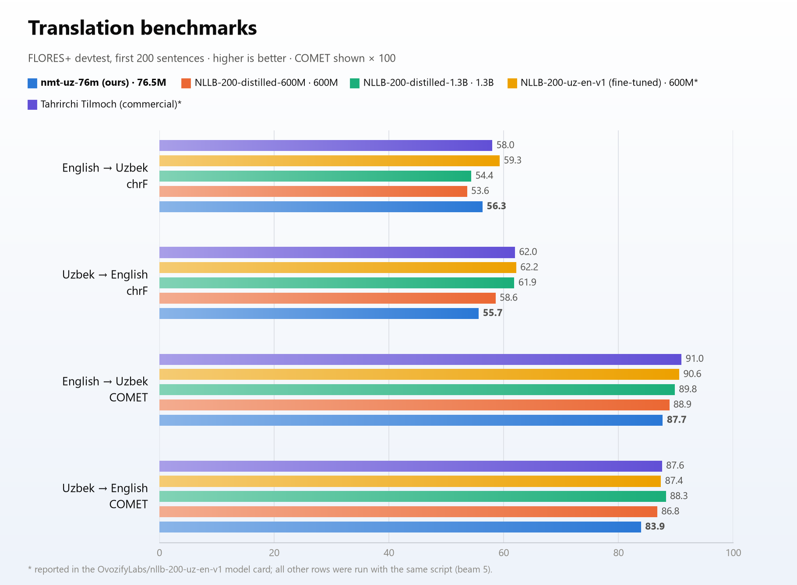
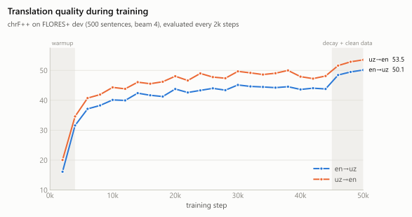
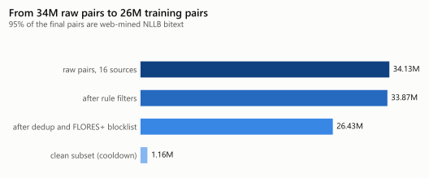
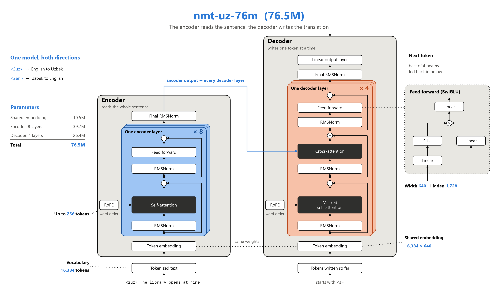

# nmt-uz: English ↔ Uzbek translation, trained from scratch


One 76.5M-parameter Transformer that translates both ways between English and Uzbek,
trained from scratch on a single T4 GPU. Uzbek is written in
the **2026 Latin alphabet** (ğ, ö, ş, ç) on both input and output; old Latin and Cyrillic
input is converted automatically, and output can be mapped back to the 1995 alphabet.

**Model:** [nickoo004/nmt-uz-76m](https://huggingface.co/nickoo004/nmt-uz-76m) · **Live demo:** [nmt-uz-demo](https://huggingface.co/spaces/nickoo004/nmt-uz-demo)

```bash
docker build -t nmt-uz .
docker run -p 8000:8000 nmt-uz
curl -X POST localhost:8000/translate -H 'Content-Type: application/json' \
     -d '{"text": "Good morning! How are you?", "target": "uz"}'
```

## Results

FLORES+ devtest (1012 sentences, never seen in training), beam 5, all three systems run
through the same script ([src/benchmark.py](src/benchmark.py)):

| System | Params | en→uz BLEU | chrF | COMET | uz→en BLEU | chrF | COMET |
|---|---:|---:|---:|---:|---:|---:|---:|
| **nmt-uz-76m (this repo)** | **76.5M** | **19.89** | **57.53** | 0.883 | 27.70 | 55.94 | 0.832 |
| NLLB-200-distilled-600M | 600M | 14.90 | 52.80 | 0.879 | 31.33 | 58.42 | 0.858 |
| NLLB-200-distilled-1.3B | 1.3B | 17.18 | 55.72 | 0.897 | 34.61 | 61.08 | 0.875 |

English → Uzbek beats both NLLB-200 models on BLEU and chrF at 8× and 17× fewer parameters.
Uzbek → English is still behind: writing English is where large multilingual models gain
the most from their size.

The chart adds two systems that only publish scores on the first 200 devtest sentences
([OvozifyLabs card](https://huggingface.co/OvozifyLabs/nllb-200-uz-en-v1#benchmark-results)),
so every row in it is scored on that subset. Our Uzbek output is converted to the 1995
alphabet the FLORES+ references use, and chrF is plain chrF (sacrebleu default), not chrF++.



### Speed

Time per sentence on the first 100 devtest sentences, en→uz / uz→en in milliseconds. "Single"
is one request at a time (median); "batch" is all 100 at once, divided by 100. 4-core CPU and
NVIDIA T4 on Modal, model loading not counted
([src/latency.py](src/latency.py)):

| Hardware | System | Beam | Single, median | Single, p95 | Batch, per sentence |
|---|---|---:|---:|---:|---:|
| 4-core CPU | **nmt-uz-76m** | 4 | **417 / 429** | **748 / 733** | **539 / 527** |
| 4-core CPU | NLLB-200-distilled-600M | 4 | 6909 / 5397 | 11676 / 8622 | 2302 / 1754 |
| 4-core CPU | **nmt-uz-76m** | 1 | **349 / 387** | **658 / 657** | **66 / 67** |
| 4-core CPU | NLLB-200-distilled-600M | 1 | 5375 / 4350 | 9406 / 7583 | 1376 / 620 |
| T4 | **nmt-uz-76m** | 4 | **195 / 206** | **335 / 347** | **37 / 33** |
| T4 | NLLB-200-distilled-600M | 4 | 585 / 454 | 951 / 738 | 83 / 59 |
| T4 | **nmt-uz-76m** | 1 | **181 / 188** | **297 / 325** | **11 / 12** |
| T4 | NLLB-200-distilled-600M | 1 | 460 / 374 | 737 / 604 | 69 / 31 |

On a CPU a sentence takes about 0.4 s against 5–7 s for NLLB-600M; on a T4 it is 2–3× faster.
With beam 4 on a CPU, batching does not help yet: the beam search spends most of its time on
per-step bookkeeping, which is the next thing to optimise.

### Precision and batch size

Seconds to translate the whole FLORES+ devtest in both directions (2024 sentences, beam 4) on
one T4, by weight precision and batch size; int8 and int4 are bitsandbytes LLM.int8 and NF4.
Quality is measured at batch 32 ([src/efficiency.py](src/efficiency.py)):

| Model | Precision | Weights | batch 1 | 8 | 32 | 64 | 128 | 256 | en→uz BLEU / chrF | uz→en BLEU / chrF |
|---|---|---:|---:|---:|---:|---:|---:|---:|---:|---:|
| NLLB-200-distilled-600M | fp32 | 2346 MB | 1453 s | 281 s | 234 s | 248 s | OOM | OOM | 14.8 / 52.7 | 31.4 / 58.4 |
| NLLB-200-distilled-600M | fp16 | 1173 MB | 1028 s | 217 s | 106 s | 108 s | 126 s | OOM | 14.8 / 52.6 | 31.3 / 58.4 |
| NLLB-200-distilled-600M | int8 | 837 MB | 3973 s | 704 s | 248 s | 168 s | 173 s | OOM | 14.8 / 52.6 | 31.1 / 58.3 |
| NLLB-200-distilled-600M | int4 | 669 MB | 1398 s | 261 s | 124 s | 100 s | 104 s | OOM | 14.6 / 51.9 | 30.9 / 58.1 |
| **nmt-uz-76m** | fp32 | 292 MB | 384 s | 60.8 s | 36.4 s | 42.6 s | 59.2 s | 95.0 s | 19.9 / 57.6 | 27.5 / 55.8 |
| **nmt-uz-76m** | fp16 | 146 MB | 381 s | 60.5 s | 25.0 s | **21.5 s** | 27.1 s | 43.8 s | 19.8 / 57.6 | 27.5 / 55.8 |
| **nmt-uz-76m** | int8 | 83 MB | 1200 s | 202 s | 69.6 s | 49.2 s | 46.3 s | 54.0 s | 19.8 / 57.5 | 27.5 / 55.8 |
| **nmt-uz-76m** | int4 | 52 MB | 562 s | 89.4 s | 39.6 s | 27.2 s | 27.8 s | 40.0 s | 19.9 / 57.4 | 27.6 / 55.9 |

The fastest setting, fp16 at batch 64, is about 5× faster than NLLB-600M at its best, and every
batch size fits in the T4's 15 GB, where NLLB runs out of memory from batch 128 or 256.
Quantizing costs our model almost nothing in quality (at most 0.2 chrF) and int4 weights are
52 MB, but bitsandbytes kernels are slower than fp16, so int8 and int4 save memory, not time.
Batches above 64 slow down again, for the same beam-search overhead as in the CPU numbers above.

### ONNX

[nickoo004/nmt-uz-76m-onnx](https://huggingface.co/nickoo004/nmt-uz-76m-onnx) has the model
in ONNX at four precisions. It runs on onnxruntime, numpy and sentencepiece, with no PyTorch
([src/onnx_export.py](src/onnx_export.py), [src/onnx_translator.py](src/onnx_translator.py)).
Quality is FLORES+ devtest at beam 5. Latency is one sentence at a time on the same 4-core
CPU, median in milliseconds, en→uz / uz→en:

| Model | Size | en→uz BLEU / chrF | uz→en BLEU / chrF | Beam 4 | Beam 1 |
|---|---:|---:|---:|---:|---:|
| PyTorch fp32 | 292 MB | 19.89 / 57.53 | 27.70 / 55.94 | 417 / 429 | 349 / 387 |
| ONNX fp32 | 372 MB | 19.88 / 57.54 | 27.70 / 55.93 | 350 / 362 | 160 / 156 |
| ONNX fp16 | 186 MB | 19.88 / 57.54 | 27.70 / 55.93 | 326 / 352 | 195 / 194 |
| **ONNX int8** | **94 MB** | 19.62 / 57.46 | 27.72 / 55.94 | **197 / 197** | **79 / 96** |
| ONNX int4 | 59 MB | 19.88 / 57.67 | 27.39 / 55.74 | 276 / 260 | 138 / 148 |

int8 is the default. It is about 2× faster than PyTorch at beam 4 and 4× faster greedy, and
stays within 0.3 BLEU. ONNX fp32 gives the same tokens as PyTorch (tested). int4 is the
smallest download, but on a CPU it runs slower than int8.

### Shorter text in the 2026 alphabet

ş ç ğ ö are one letter where the 1995 alphabet used two (sh ch gʻ oʻ). On the Uzbek side of
FLORES+ devtest ([scripts/token_savings.py](scripts/token_savings.py)):

| 1012 sentences | 1995 alphabet | 2026 alphabet |
|---|---:|---:|
| Characters | 149,337 | 143,153 (−4.1%) |
| Tokens, our tokenizer | ~34,800 (estimate) | 33,387 |

About 4% fewer tokens means about 4% fewer decoder steps for English → Uzbek. The 1995
count assumes the same characters per token in both spellings; our tokenizer run directly
on 1995 text gives 43,799 tokens, but only because it was trained on the new letters, so
that is not a saving.

Quality on FLORES+ dev during training (500 sentences, beam 4). The jump after 45k is the
learning-rate decay on clean data:

<picture>
  <source media="(prefers-color-scheme: dark)" srcset="docs/img/training_curve-dark.svg">
  
</picture>

## Use it

**Python**

```python
from src.inference import Translator

tr = Translator.from_pretrained("nickoo004/nmt-uz-76m")   # or a local release/ directory
tr.translate("The library opens at nine.", target="uz")
tr.translate(["Ўзбекистон пойтахти", "Oʻzbekiston poytaxti"], target="en")
tr.translate("Good idea.", target="uz", script="old")    # gʻ oʻ sh ch instead of ğ ö ş ç
```

**ONNX, without PyTorch** (`pip install onnxruntime numpy sentencepiece huggingface_hub`)

```python
from src.onnx_translator import OnnxTranslator

tr = OnnxTranslator.from_pretrained("nickoo004/nmt-uz-76m-onnx", precision="int8")
tr.translate("The library opens at nine.", target="uz")   # same arguments as Translator
```

**HTTP** (`docker compose up`, then open `localhost:8000/docs`)

| Endpoint | Body |
|---|---|
| `POST /translate` | `{"text": str or [str], "target": "uz" or "en", "beam": 1-8, "script": "new" or "old"}` |
| `GET /health` | model id and device |

Up to 64 strings of 2000 characters per request. Speed on CPU and GPU is in
[Results](#speed).

## Deploy

Weights are not baked into the image. `MODEL_ID` picks a Hugging Face repo (downloaded once
and cached in the `/cache` volume) or a mounted directory:

```bash
docker build -t nmt-uz .                                    # CPU image, ~1.7 GB
docker compose up -d                                        # port 8000, cache volume, restarts

# weights from a local release/ directory instead of the Hub
docker run -p 8000:8000 -e MODEL_ID=/model -v "$PWD/release:/model:ro" nmt-uz

# NVIDIA GPU
docker build --build-arg TORCH_INDEX=cu128 -t nmt-uz:cuda .
docker run --gpus all -p 8000:8000 nmt-uz:cuda
```

For production:

- `GET /health` is the readiness probe; the image has a `HEALTHCHECK` with a 3 minute start
  period for the first download.
- The container runs as a non-root user. Mount `/cache` on a persistent volume so restarts
  skip the download.
- Each process holds its own copy of the model (about 300 MB of fp32 weights plus PyTorch).
  Scale with more replicas behind a load balancer rather than more threads per process.
- The API has no authentication or rate limiting; put it behind your gateway.

## How it works

**Alphabet.** Uzbek data on the web is a mix of Cyrillic, 1995 Latin (with five different
apostrophes for oʻ/gʻ) and partial conversions. Everything goes through one converter
(`src/data_pipeline/alphabet.py`) into the 2026 alphabet, so the model sees one spelling
per word and the tokenizer does not waste pieces on `o'`, `oʻ`, `o‘` and `ў`.

**Data.** 34.1M raw pairs from 16 sources ([data/SOURCES.md](data/SOURCES.md)) become 26.4M
training pairs (910M tokens):

- rule filters: length ratio, copies, markup, non-text, over-long pairs;
- exact and near-duplicate removal on 64-bit hashes with polars, sources in priority
  order so the cleaner copy of a pair survives; at most 3 translations per sentence;
- every FLORES+ sentence on either side is blocklisted (6 leaked NLLB pairs removed).

<picture>
  <source media="(prefers-color-scheme: dark)" srcset="docs/img/data_funnel-dark.svg">
  
</picture>

Some findings from the audit: one Hugging Face dataset is a byte-for-byte copy of another,
two others are over 99% duplicates of other sources, and 95% of what remains comes from mined NLLB
bitext. That last fact shaped the training recipe. Per-source counts are in
[results/data_stats.json](results/data_stats.json).

**Model.** Encoder-decoder Transformer written from scratch in PyTorch
(`src/models/transformer.py`): 8 encoder and 4 decoder layers (a deep encoder and shallow
decoder decode faster for the same quality), d=640, RMSNorm, RoPE, SwiGLU, tied
embeddings, 16k shared SentencePiece vocabulary. Direction is a target tag, `<2uz>` or
`<2en>`, so one model serves both directions.



**Training** (`configs/base.yaml`, `src/training/trainer.py`):

- token-budget batches of 12k tokens, 2 accumulated per step, fp16 with the loss in fp32;
- warmup-stable-decay schedule: 4k warmup, flat 7e-4, linear decay over the last 10%;
- during the decay 70% of batches come from the 1.16M clean pairs (TED, Wikipedia,
  curated sets), so the mined data teaches coverage and the clean data sets the style;
- cross-entropy from [A Fix for Softmax and Cross-Entropy](https://arxiv.org/abs/2610.31642),
  which keeps gradients alive for confident tokens under fp16;
- best checkpoint by mean chrF++ on FLORES+ dev; preempted GPUs resume from the last
  500-step checkpoint with the RNG state restored.

## Reproduce

```bash
uv sync
uv run pytest
modal secret create huggingface HF_TOKEN=...          # FLORES+ is gated
modal run modal_app.py::build                          # corpus, tokenizer, stores (~1 h CPU)
modal run --detach modal_app.py::train --run base      # ~19 h on a T4
modal run modal_app.py::benchmark --system ours --run base
python -m src.export --checkpoint runs/base/best.pt --tokenizer data/processed/spm/spm.model
```

| Stage | Hardware | Time |
|---|---|---|
| Corpus build | 16 CPU | ~1 h |
| Main training, 50k steps | T4 | ~19 h |
| Evaluation and benchmark | T4 | <1 h |

## Layout

```
src/data_pipeline/   alphabet conversion, cleaning, dedup, sources, tokenizer, corpus build
src/models/          the Transformer
src/training/        token-budget batching, stable cross-entropy, trainer
src/evaluation/      beam search translation, BLEU / chrF++
src/benchmark.py     FLORES+ comparison with NLLB-200, COMET
src/export.py        checkpoint -> safetensors release
src/inference.py     Translator
src/onnx_export.py   release -> ONNX encoder and decoder, fp32 / fp16 / int8 / int4
src/onnx_translator.py  OnnxTranslator: beam search in numpy, no PyTorch
src/serve.py         FastAPI service
modal_app.py         everything above on Modal
scripts/             README figures and an end-to-end smoke test
results/             data statistics, training metrics, benchmark outputs
```

## Limitations

- Trained mostly on web-mined text: news and encyclopedic sentences go well, slang,
  poetry and long documents less so. Long inputs are split into sentences.
- 2026 alphabet output is new; most existing Uzbek software and corpora still use the
  1995 alphabet (`script="old"` exists for that).
- Code and weights are for non-commercial use only (code: PolyForm Noncommercial 1.0.0,
  weights: CC BY-NC 4.0). For commercial use, contact the author.

## References

1. Vaswani et al. (2017). *Attention Is All You Need.* [arXiv:1706.03762](https://arxiv.org/abs/1706.03762)
2. NLLB Team (2022). *No Language Left Behind: Scaling Human-Centered Machine Translation.* [arXiv:2207.04672](https://arxiv.org/abs/2207.04672)
3. Hu et al. (2024). *MiniCPM: Unveiling the Potential of Small Language Models with Scalable Training Strategies* (warmup-stable-decay schedule). [arXiv:2404.06395](https://arxiv.org/abs/2404.06395)
4. Barron, Gnanapragasam & Tschannen (2026). *A Fix for Softmax and Cross-Entropy* (the training loss). [arXiv:2610.31642](https://arxiv.org/abs/2610.31642)

## License

Non-commercial use only: the code is under [PolyForm Noncommercial 1.0.0](LICENSE) and the
weights under CC BY-NC 4.0. Commercial use needs written permission. Contact Nursultan
Koshekbaev at [nursultankoshekbaev477@gmail.com](mailto:nursultankoshekbaev477@gmail.com) or on
[LinkedIn](https://www.linkedin.com/in/nursultan-koshekbaev/).
